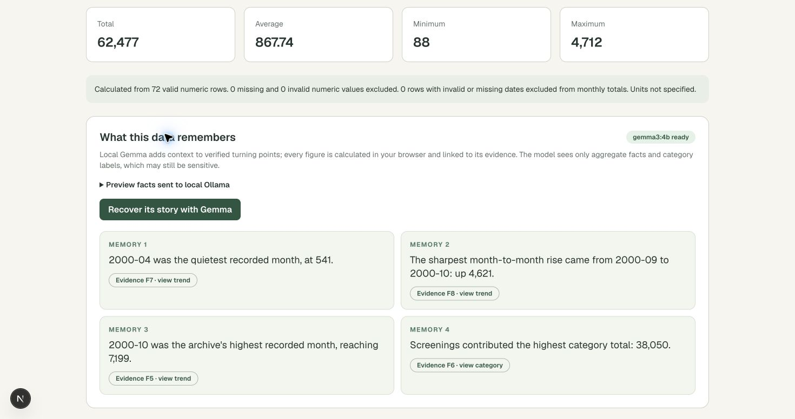

# DataAfterlife

**Explore a historical CSV, ask questions in plain language, and recover a story you can trace back to the data.** DataAfterlife combines browser-side calculations with a local Gemma 3 model through Ollama. The model interprets questions and selects story beats; it does not calculate the displayed numbers.



## What you can do

- Choose a CSV or drag and drop one, then map its numeric, date, and category columns.
- Inspect a ten-row preview, totals, average, minimum, maximum, monthly trend, and category totals.
- Switch the canvas charts between line, bar, area, and pie views where available.
- Ask questions about totals, averages, medians, filters, ranked rows, and groups by category, year, quarter, or month. The app shows progress while the local model interprets the question and a Web Worker calculates the answer.
- Generate **What this data remembers**, a short story linked to verified turning points, and save a report as PDF through the browser's print dialog.

The included [fictional cinema ledger](data-afterlife/public/examples/forgotten-cinema-ledger.csv) has 72 records from 1999–2000. Its total is **62,477 units**. April 2000 is the lowest month at **541**, October 2000 is the highest at **7,199**, and **2000** has the highest yearly total at **32,033**. Other included samples are [expenses](data-afterlife/public/examples/sample-expenses.csv), a [1,000-row, 50-column synthetic dataset](data-afterlife/public/examples/synthetic-1000x50.csv), and a [synthetic hydrogen plant dataset](data-afterlife/public/examples/synthetic-hydrogen-plant-1000x50.csv).

## Run locally

You need **Node.js 20+**, npm, and [Ollama](https://ollama.com/). From the repository root:

```bash
cd data-afterlife
npm install
ollama pull gemma3:4b
cp .env.example .env.local
npm run dev
```

Make sure Ollama is running. If it is not started by your Ollama installation, run `ollama serve` in another terminal. Open <http://localhost:3000>.

The default `.env.example` points to `http://127.0.0.1:11434` and uses `gemma3:4b`. Set `OLLAMA_BASE_URL` and `OLLAMA_MODEL` in `.env.local` if your local service or model differs. Charts and CSV statistics still work when Ollama is unavailable; the AI story and natural-language questions require it.

## Try the demo

1. Click **Explore the cinema archive** to load and analyze the fictional ledger. The page scrolls to the result.
2. Inspect **Monthly trend** and **Category totals**, then switch a chart type.
3. When the badge says `gemma3:4b ready`, open **Preview facts sent to local Ollama** and click **Recover its story with Gemma**. Follow a story card's evidence link.
4. Ask “Which year has the highest amount?” The result is **2000: 32,033 units**. You can also ask for the average of the three lowest amount values or the highest month.
5. Use **Save report as PDF** and choose a PDF destination in the browser print dialog.

## How the answers stay grounded

The app parses and aggregates CSV rows in a browser Web Worker. For natural-language questions, Gemma sees the question and column names and proposes a constrained plan. The app checks the plan against the question and known columns, corrects clear time-grouping mismatches, and executes the calculation from the rows in the worker. It can retry a mismatched plan once. If a question needs information absent from the CSV or a calculation it cannot support, it may return an unsupported response rather than a fabricated value.

For the story, the app sends Ollama a small packet of calculated aggregate facts. It anchors the low point, largest consecutive monthly rise, and high point when available. Gemma chooses additional context from those facts; the app renders the final numbers and evidence links from verified calculations. The story does not infer a cause from an event note or forecast the future.

This is a constrained question system, not a guarantee that every possible wording will be understood. Check the displayed calculation and source data before using a result for a consequential decision.

## CSV requirements and error handling

| Requirement | Current limit or behavior |
| --- | --- |
| File | One `.csv` file, UTF-8, up to 5 MB |
| Size | Up to 10,000 data rows and 50 columns |
| Dates | `YYYY-MM-DD` by default; select `DD/MM/YYYY` or `MM/DD/YYYY` for slash dates |
| Numbers | Currency symbols and comma group separators are handled only when you enable those options |
| Missing values | Missing and invalid numbers are excluded and counted; invalid dates are excluded from time groups |

Empty files, wrong extensions, missing headers or data rows, size-limit violations, and worker failures show an error below the upload area. Some malformed rows are shown as **parse warnings** in the dataset preview, and the app may still analyze the rows it could parse. Review warnings and the preview before relying on the result.

## Privacy and deployment

CSV bytes and rows stay in browser memory and are cleared on reload. The local Next.js AI routes receive only a question plus column metadata, or selected aggregate facts for the story. They do not receive raw CSV rows. Questions and category labels can still be sensitive; inspect the fact preview before requesting a story.

This project is designed to run locally. A hosted Next.js server would contact the server's configured Ollama instance, not a visitor's local Ollama. A public hosted demo with AI would need a separate deployment and privacy design. For the Hacktoberfest submission, a local video walkthrough can demonstrate the complete flow.

## Development checks

Run from `data-afterlife`:

```bash
npx vitest run
npm run lint
npx tsc --noEmit
npm run build
```

The app uses Next.js, React, TypeScript, Tailwind CSS, Papa Parse, Chart.js canvas charts, Zod, browser Web Workers, Ollama, and Gemma 3. Source code and tests are in [`data-afterlife`](data-afterlife/). The [Week 4 write-up draft](data-afterlife/docs/hacktoberfest-week4-submission.md) includes a recording outline.
